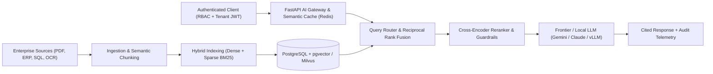
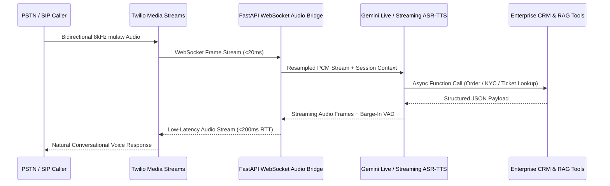
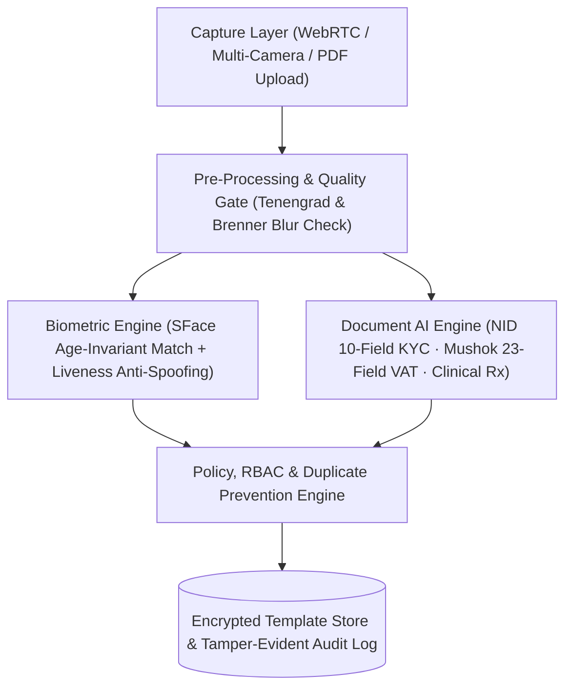

# Enterprise AI & Multi-Cloud Reference Architectures

**Author:** [Md Bazlur Rahman Likhon](https://github.com/brlikhon) — Senior Cloud & AI Engineer at UPSTRA Communications Ltd.  
**Focus:** Production Enterprise RAG · Agentic Workflows · Sub-200ms Voice AI · Sovereign Biometric & Document AI · Multi-Cloud DevSecOps

---

## 1. Multi-Tenant Hybrid Enterprise RAG Architecture (99%+ Retrieval Precision)

Designed for regulated banking, pharmaceutical, and enterprise knowledge workloads handling **100,000+ daily queries** across **50,000+ heterogeneous documents** with strict tenant isolation, citation grounding, and cost-optimized token routing.

### Architectural Highlights
- **Hybrid Retrieval + Reranking:** Combines HNSW dense vector search (`pgvector` / `Milvus`) with lexical BM25 retrieval and Reciprocal Rank Fusion (RRF) to preserve exact policy codes, SKUs, and financial terms.
- **Token & Cost Optimization:** Semantic Redis caching, context compression, and tiered model routing cut production inference spend by **66–83%** (proven in *McKrishiSheba* and enterprise knowledge deployments).
- **Zero-Hallucination Governance:** Enforces strict schema-constrained outputs, inline chunk citations, tenant-level row security, and immutable audit logs.

---

## 2. Sub-200ms Real-Time Voice AI Bridge (Bangla & Multilingual Telephony)

Production voice automation architecture powering 24/7 inbound/outbound enterprise call centers with native South Asian (**Bangla-first** & English) prosody, barge-in handling, and live CRM tool execution.

### Architectural Highlights
- **Ultra-Low Latency (<200ms):** Asynchronous Python `FastAPI` WebSocket media bridge with zero-copy audio buffering, Voice Activity Detection (VAD) interruption handling, and streaming tool calls.
- **Operational Impact:** Automates tier-1/tier-2 customer support 24/7, reducing contact-center operational overhead by up to **60%**.

---

## 3. Sovereign Banking e-KYC, Biometric & Document Intelligence Pipeline

Engineered for financial institutions, manufacturing facilities, and government compliance workflows requiring **data residency**, **anti-spoofing liveness**, and **high-precision Bangla/English OCR**.

### Architectural Highlights
- **Zero Raw Biometric Retention:** Stores encrypted mathematical feature templates rather than raw biometric imagery where required by compliance, backed by short-lived mTLS/JWT tokens.
- **Domain-Specific Document Parsers:** Production extractors for Bangladeshi **National ID (NID)** bilingual cards, **Mushok-6.3 VAT** invoices (23 validated fields + automated tax math), and **multi-hypothesis medical prescription** matching.

---

## 4. Multi-Cloud Zero-Trust & MLOps Delivery Platform

Unified Infrastructure-as-Code (`Terraform`, `Helm`, `Kubernetes`) and automated model lifecycle governance across **Google Cloud, Microsoft Azure, AWS, and Oracle Cloud Infrastructure (OCI)**.

- **Deployment Velocity:** Automated CI/CD + CT (Continuous Training) via `GitHub Actions`, `Azure DevOps`, `ArgoCD`, and `MLflow` — accelerating release cycles by **10x** while maintaining **99.9% availability**.
- **Security Posture:** IAM least-privilege workload identity federation, network micro-segmentation, secret vaulting, and automated compliance controls aligned with **SOC2, HIPAA, and GDPR**.

---

### Work With Md Bazlur Rahman Likhon
- **Book a 30-Minute Architecture Discovery Call:** [cal.com/brlikhon.engineer/discovery](https://cal.com/brlikhon.engineer/discovery)
- **LinkedIn:** [linkedin.com/in/bazlur-rahman-likhon](https://www.linkedin.com/in/bazlur-rahman-likhon/)
- **Email:** [contact@brlikhon.engineer](mailto:contact@brlikhon.engineer)
