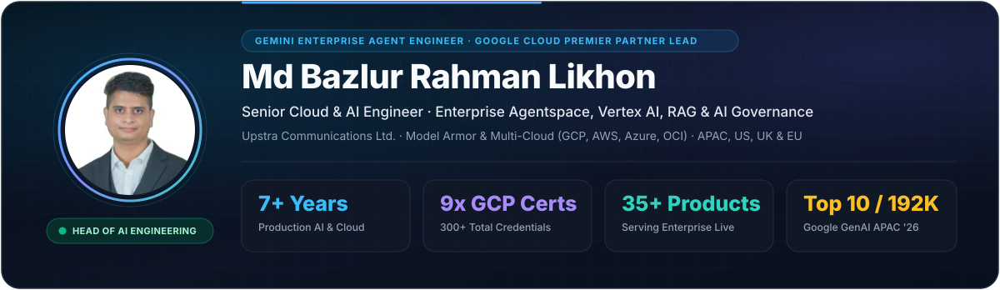

  🌐 <b>উপলব্ধ ভাষাসমূহ (Languages):</b> &nbsp;
  <a href="../README.md"><b>English</b></a> &nbsp;·&nbsp;
  <a href="./README.bn.md"><b>বাংলা</b></a> &nbsp;·&nbsp;
  <a href="./README.ar.md"><b>العربية</b></a> &nbsp;·&nbsp;
  <a href="./README.fr.md"><b>Français</b></a> &nbsp;·&nbsp;
  <a href="./README.de.md"><b>Deutsch</b></a> &nbsp;·&nbsp;
  <a href="./README.zh-CN.md"><b>简体中文</b></a> &nbsp;·&nbsp;
  <a href="./README.ja.md"><b>日本語</b></a>

<picture>
  <source media="(prefers-color-scheme: dark)" srcset="../assets/hero-dark.svg" />
  <source media="(prefers-color-scheme: light)" srcset="../assets/hero-light.svg" />
  
</picture>

<h1 align="center">AI Engineer (Gemini Enterprise Agent Engineer) · Senior Cloud &amp; AI Engineer · Head of AI Engineering</h1>

  
  
  
  
  

---

## সংক্ষিপ্ত নির্বাহী পরিচিতি — মোঃ বজলুর রহমান লিখন (`Md Bazlur Rahman Likhon`)

**মোঃ বজলুর রহমান লিখন** (`@brlikhon`) বর্তমানে **Upstra Communications Limited** *(Google Cloud Premier Partner)*-এ **সিনিয়র ক্লাউড অ্যান্ড এআই ইঞ্জিনিয়ার, Gemini Enterprise Agent Engineer এবং হেড অব এআই ইঞ্জিনিয়ারিং (Head of AI Engineering)** হিসেবে কর্মরত আছেন। **৭+ বছরের অভিজ্ঞতা**, **Bangladesh University of Professionals (BUP)**-এ চলমান **MSc in Information Systems Security**, **৯টি অফিশিয়াল Google Cloud সার্টিফিকেশন**, **৬টি Microsoft Azure সার্টিফিকেশন**, **৩টি Oracle Cloud সার্টিফিকেশন** এবং **হার্ভার্ড, স্ট্যানফোর্ড, কলাম্বিয়া, Linux Foundation, IBM ও DeepLearning.AI** থেকে অর্জিত **৩২৫+ ভেরিফায়েড সার্টিফিকেশন** নিয়ে তিনি বাংলাদেশ, সিঙ্গাপুর/APAC, যুক্তরাষ্ট্র, যুক্তরাজ্য, ইউরোপ, জাপান ও চীনের শীর্ষ প্রতিষ্ঠানের জন্য প্রোডাকশন-গ্রেড এন্টারপ্রাইজ এআই প্রোডাক্ট এবং মাল্টি-ক্লাউড সিস্টেম নেতৃত্ব দিচ্ছেন।

মূল দক্ষতার ক্ষেত্রসমূহ: **Gemini Enterprise (`Google Agentspace`), Vertex AI Agent Builder, মাল্টি-এজেন্ট অর্কেস্ট্রেশন, এন্টারপ্রাইজ সার্চ ও RAG, এআই গভর্ন্যান্স ও সিকিউরিটি (`Google Cloud Model Armor`), রিয়েল-টাইম বাংলা ও বহুভাষিক ভয়েস এআই, হাসপাতাল ও ক্লিনিক্যাল ম্যানেজমেন্ট প্ল্যাটফর্ম, অমনিচ্যানেল এআই ওয়ার্কফোর্স, বায়োমেট্রিক ই-কেওয়াইসি (`e-KYC`) এবং মাল্টি-ক্লাউড ডেভসেকঅপস**।

---

## এন্টারপ্রাইজে চলমান কমার্শিয়াল এআই প্রোডাক্টসমূহ (লাইভ ডেমোর জন্য উপলব্ধ)

> **🏢 প্রোডাকশন এন্টারপ্রাইজ প্রোডাক্ট — লাইভ ডেমোর জন্য অনুরোধ করুন:** নিচের প্ল্যাটফর্মগুলো **সংবাদমাধ্যম, হাসপাতাল ও স্বাস্থ্যসেবা, টেলিকমিউনিকেশন, ব্যাংকিং, রিটেইল এবং কর্পোরেট সিকিউরিটি খাতে সরাসরি সেবা প্রদানকারী কমার্শিয়াল এন্টারপ্রাইজ প্রোডাক্ট**। ক্লায়েন্টের গোপনীয়তা ও প্রোপ্রাইটরি মেধাস্বত্ব (IP) সুরক্ষার স্বার্থে এখানে শুধুমাত্র **প্রোডাক্টের মূল ফিচার, নিরাপত্তা/গভর্ন্যান্স সক্ষমতা এবং ব্যবসায়িক ফলাফল** তুলে ধরা হয়েছে।  
> 👉 **আপনার প্রতিষ্ঠানের জন্য লাইভ প্রোডাক্ট ডেমো দেখতে:** **[📅 লাইভ ডেমো শিডিউল করুন](https://cal.com/brlikhon.engineer/discovery)** &nbsp;|&nbsp; **[📧 ডেমোর জন্য ইমেইল করুন](mailto:contact@brlikhon.engineer?subject=Enterprise%20AI%20Product%20Live%20Demo%20Request)**

### ১. 📰 Ask Prothom Alo — এন্টারপ্রাইজ মাল্টিমোডাল এআই নিউজ ও রিয়েল-টাইম সার্চ প্ল্যাটফর্ম
- **এন্টারপ্রাইজ ডিপ্লয়মেন্ট:** বাংলাদেশের সর্ববৃহৎ সংবাদমাধ্যম প্রতিষ্ঠানের জন্য নির্মিত ও পরিচালিত।
- **মূল প্রোডাক্ট ফিচারসমূহ:** বাংলা ও ইংরেজি উভয় ভাষায় কথোপকথনভিত্তিক সংবাদ অনুসন্ধান (**৯৯.৯৯৫% আর্কাইভ কাভারেজ**), প্রতি **১৫ মিনিটে লাইভ ব্রেকিং নিউজ আপডেট**, **৩০০ মিলিসেকেন্ডের কম সময়ে** তাৎক্ষণিক স্ট্রিমিং উত্তর, ভিডিও সংবাদের ওপর মাল্টিমোডাল প্রশ্নোত্তর, ধারাবাহিক কথোপকথন স্মৃতি এবং কঠোর সম্পাদকীয় এআই গভর্ন্যান্স (সঠিক সংবাদ সূত্র উল্লেখ, তথ্য-প্রমাণ যাচাই এবং প্রত্যাহারকৃত সংবাদের স্বয়ংক্রিয় কমপ্লায়েন্স)।
- **[📅 এন্টারপ্রাইজ লাইভ ডেমোর অনুরোধ করুন →](https://cal.com/brlikhon.engineer/discovery)**

### ২. 🏢 UPSTRA OMS — স্বয়ংক্রিয় মাল্টি-এজেন্ট এআই ওয়ার্কফোর্স, বিজনেস টেলিফোনি ও অমনিচ্যানেল প্ল্যাটফর্ম
- **মাল্টি-টেন্যান্ট এন্টারপ্রাইজ প্রোডাক্ট:** একটি সমন্বিত ওয়ার্কস্পেস থেকে **ইনবাউন্ড/আউটবাউন্ড ফোন লাইন, লাইভ ভয়েস/ভিডিও মিটিং এবং ১১টিরও বেশি ডিজিটাল মেসেজিং চ্যানেলে** স্বয়ংক্রিয় এআই কর্মী নিয়োগের সুবিধা।
- **মূল প্রোডাক্ট ফিচারসমূহ:** কাস্টমার রিসেপশন, লিড কোয়ালিফিকেশন, অ্যাপয়েন্টমেন্ট বুকিং, অর্ডার ও ডেলিভারি ট্র্যাকিং, ক্যাটালগ ও ইনভেন্টরি তথ্য, ইনভয়েসিং, নির্ধারিত সময়ে আউটবাউন্ড কল ক্যাম্পেইন এবং **লাইভ হুইস্পার কোচিংসহ** মানব এজেন্টের কাছে স্মার্ট হ্যান্ডঅফ; প্রাকৃতিক বাংলা ও বৈশ্বিক বহুভাষিক কথোপকথন, কথার মাঝে তাৎক্ষণিক ইন্টারাপশন হ্যান্ডলিং, মাল্টি-টেন্যান্ট আইসোলেশন, রোল-ভিত্তিক অ্যাক্সেস (`RBAC`), অ্যাপ্রুভাল-নিয়ন্ত্রিত অ্যাকশন, লাইভ বিলিং ট্র্যাকিং এবং পূর্ণাঙ্গ অডিট লগ।
- **[📅 এন্টারপ্রাইজ লাইভ ডেমোর অনুরোধ করুন →](https://cal.com/brlikhon.engineer/discovery)**

### ৩. 🏥 MedOps CareLoop (HMS) — ক্লোজড-লুপ পপুলেশন হেলথ ও মাল্টি-টেন্যান্ট হাসপাতাল ম্যানেজমেন্ট প্ল্যাটফর্ম
- **ক্লিনিক্যাল ও হাসপাতাল এন্টারপ্রাইজ প্রোডাক্ট:** অস্বাভাবিক ডায়াগনস্টিক রিপোর্ট শনাক্ত হওয়া থেকে চূড়ান্ত চিকিৎসা গ্রহণ পর্যন্ত রোগীর ড্রপ-অফ বা ফলো-আপ বিচ্ছিন্নতা সম্পূর্ণ দূর করে।
- **মূল প্রোডাক্ট ফিচারসমূহ:** অস্বাভাবিক টেস্ট রেজাল্টের স্বয়ংক্রিয় শনাক্তকরণ, **রিয়েল-টাইম SLA ট্র্যাকিংসহ** নির্ধারিত ক্লিনিক্যাল দায়িত্ব প্রদান, **৭-ধাপের সমন্বিত চিকিৎসা ওয়ার্কফ্লো**, রোগীর বোধগম্যতা যাচাই, বিশেষজ্ঞ চিকিৎসকদের দ্বিপাক্ষিক রেফারেল হ্যান্ডঅফ এবং **৫-ধাপের প্রমাণভিত্তিক কেস ক্লোজার**; চিকিৎসকের বাধ্যতামূলক তত্ত্বাবধানে ক্লিনিক্যাল ও রোগী যোগাযোগ সহায়তা, **ওষুধের প্রেসক্রিপশন কনট্রাইন্ডিকেশন সেফটি চেক** (কিডনির কার্যকারিতা, অ্যালার্জি, ডুপ্লিকেট থেরাপি ও গর্ভাবস্থা যাচাই), হাসপাতালের ডেটা আইসোলেশন এবং অপরিবর্তনীয় ক্লিনিক্যাল অডিট ট্রেইল।
- **[📅 এন্টারপ্রাইজ লাইভ ডেমোর অনুরোধ করুন →](https://cal.com/brlikhon.engineer/discovery)**

### ৪. 📞 Upstra Interpreter — এন্টারপ্রাইজ দ্বিমুখী টেলিফোন ইন্টারপ্রিটেশন প্ল্যাটফর্ম
- **সেলফ-হোস্টেড কমার্শিয়াল টেলিফোনি প্রোডাক্ট:** কাস্টমার ও অপারেটরের মধ্যে সরাসরি ফোন কলে স্বাভাবিক কথোপকথনের মাধ্যমে রিয়েল-টাইম দ্বিমুখী কণ্ঠস্বর অনুবাদ সেবা।
- **মূল প্রোডাক্ট ফিচারসমূহ:** চলমান ফোন কলে উভয় পক্ষের কাছে তাৎক্ষণিক ও স্পষ্ট অনূদিত কণ্ঠস্বর পৌঁছে দেয়; **সেলফ-হোস্টেড এন্টারপ্রাইজ ডিপ্লয়মেন্ট** প্রতিষ্ঠানের সম্পূর্ণ ডেটা নিয়ন্ত্রণ, কলের গোপনীয়তা এবং কর্পোরেট টেলিফোনি সিকিউরিটি ও রাউটিং নীতিমালার শতভাগ সুরক্ষা নিশ্চিত করে। এতে রয়েছে অপারেটর ও কল ক্যাপাসিটি ম্যানেজমেন্ট, লাইভ অপারেশনাল ড্যাশবোর্ড, সিস্টেম হেলথ মনিটরিং এবং পূর্ণাঙ্গ কল হিস্ট্রি ও কমপ্লায়েন্স অডিট রেকর্ড।
- **[📅 এন্টারপ্রাইজ লাইভ ডেমোর অনুরোধ করুন →](https://cal.com/brlikhon.engineer/discovery)**

### ৫. 🌐 Live Voice Translation Platform — গ্লোবাল রিয়েল-টাইম স্পিচ-টু-স্পিচ অনুবাদ প্ল্যাটফর্ম
- **মূল প্রোডাক্ট ফিচারসমূহ:** ওয়েব ব্রাউজার এবং মোবাইল/ফোন নাম্বারের মাধ্যমে **৫০টিরও বেশি আন্তর্জাতিক ভাষায়** **৩০০ মিলিসেকেন্ডের কম ল্যাটেন্সিতে** রিয়েল-টাইম দ্বিমুখী কণ্ঠস্বর অনুবাদ সেবা, যা লাখো সমসাময়িক সেশন পরিচালনায় সক্ষম।
- **[📅 এন্টারপ্রাইজ লাইভ ডেমোর অনুরোধ করুন →](https://cal.com/brlikhon.engineer/discovery)**

### ৬. 🌱 CropMind, 🧠 এন্টারপ্রাইজ সার্চ, 🎙️ বাংলা ভয়েস কল সেন্টার ও 🏦 ব্যাংকিং e-KYC ও ডকুমেন্ট স্যুট
- **CropMind:** *Google Cloud Gen AI Academy APAC 2026 Grand Finale*-তে **১,৯২,৬৬০ জন প্রতিযোগীর মধ্যে Top 10** অর্জনকারী একমাত্র বাংলাদেশি প্রজেক্ট (ফসলের রোগ নির্ণয়, আবহাওয়াভিত্তিক ফলন পূর্বাভাস ও বহুভাষিক কৃষি পরামর্শ)।
- **মাল্টি-টেন্যান্ট এন্টারপ্রাইজ নলেজ ও সার্চ প্ল্যাটফর্ম:** ৫০,০০০+ প্রাতিষ্ঠানিক ডকুমেন্টে **দৈনিক ১,০০,০০০+ কুয়েরি** এবং **৯৯%+ নির্ভুল উত্তর**।
- **বাংলা-ফার্স্ট ভয়েস এআই কল সেন্টার (`<200ms`):** ২৪/৭ স্বয়ংক্রিয় ইনবাউন্ড/আউটবাউন্ড ফোন সেবা, যা কল সেন্টার খরচ **৬০% পর্যন্ত হ্রাস করে**।
- **ব্যাংকিং e-KYC, বায়োমেট্রিকস, কর্মক্ষেত্র নিরাপত্তা ও ডকুমেন্ট ইন্টেলিজেন্স:** ব্যাংকিং `KYC Face Match`, **FaceTrack AI** অ্যাটেনডেন্স সিস্টেম (২০ বছরের বয়স-সহনশীলতা, লাইভনেস অ্যান্টি-স্পুফিং ও ২৮+ এন্টারপ্রাইজ API), ফিঙ্গারপ্রিন্ট ভেরিফিকেশন, **GuardZone** সিকিউরিটি গার্ড মনিটরিং, **WorkStation Monitoring** কর্মী অ্যানালিটিক্স, **LunchGate** কর্পোরেট ক্যাফেটেরিয়া ভেরিফিকেশন, **Conversational BI**, দ্বিভাষিক **বাংলাদেশ NID e-KYC** (১০টি ফিল্ড), **মূসক ৬.৩ ভ্যাট চালান অটোমেশন** (২৩টি ফিল্ড), মেডিকেল প্রেসক্রিপশন এক্সট্রাকশন, **McKrishiSheba** (**৬৬–৮৩% এআই খরচ সাশ্রয়**) এবং নেটওয়ার্ক ইনট্রুশন ডিটেকশন (**৯৯.৮৭% নির্ভুলতা** — [পাবলিক রিপোজিটরি](https://github.com/brlikhon/Network-Intrusion-dataset-CIC-IDS--2017-))।

---

## কর্মঅভিজ্ঞতা ও শিক্ষাগত যোগ্যতা

- **Senior Cloud & AI Engineer *(Head of AI Engineering)*** — **Upstra Communications Limited** *(Google Cloud Premier Partner · অক্টোবর ২০২৫ – বর্তমান)*: শীর্ষ সংবাদমাধ্যম, ব্যাংক, হাসপাতাল ও ফার্মাসিউটিক্যাল প্রতিষ্ঠানের জন্য `Gemini Enterprise / Agentspace`, `Vertex AI` এবং `Google Cloud Model Armor` গভর্ন্যান্সসহ কমার্শিয়াল এআই প্রোডাক্ট ডেলিভারি ও টিম নেতৃত্ব।
- **Cloud Engineer** — **Kamal-Paterson Ltd & KPCloud** *(সেপ্টেম্বর ২০২৩ – অক্টোবর ২০২৫)*: কমার্শিয়াল এআই অ্যাপ্লিকেশন এবং AWS-এ ৬টি SaaS প্রোডাক্ট পোর্টফোলিও নির্মাণ এবং যুক্তরাষ্ট্র, যুক্তরাজ্য, জাপান ও চীনের ক্লাউড প্রজেক্টে অবদান।
- **Cloud Trainer** — **Inflexionpoint Technologies BD Ltd.** *(আগস্ট ২০২৩ – নভেম্বর ২০২৩)*: AWS, Azure ও ML ডিপ্লয়মেন্টে হাতে-কলমে প্রশিক্ষণ প্রদান (**৮০% দক্ষতা বৃদ্ধি**)।
- **Researcher** — **DIU NLP & ML Research Lab, Daffodil International University** *(জুন ২০২০ – আগস্ট ২০২৩)*: বাংলা ভাষা কম্পিউটেশন ও **২৪ লক্ষ টুইট** বিশ্লেষণ করে গবেষণাপত্র প্রকাশ।
- **শিক্ষাগত যোগ্যতা:** **MSc in Information Systems Security (MISS)** — বাংলাদেশ ইউনিভার্সিটি অব প্রফেশনালস (BUP) *(চলমান)* · **BSc in Computer Science & Engineering** — ড্যাফোডিল ইন্টারন্যাশনাল ইউনিভার্সিটি *(GPA: 3.62 / 4.00)*।

---

## ৯টি Google Cloud সার্টিফিকেশন ও ৩২৫+ ভেরিফায়েড ক্রেডেনশিয়াল

> 📜 **[সকল ৩২৫+ সার্টিফিকেশনের সরাসরি ভেরিফিকেশন লিংকসহ পূর্ণাঙ্গ তালিকা দেখুন (CERTIFICATIONS.md)](../CERTIFICATIONS.md)**

- **Google Cloud (৯টি অফিশিয়াল সার্টিফিকেশন):** Professional Machine Learning Engineer ([Verify](https://www.credly.com/badges/24cbf5fd-fa4f-46a3-9ff2-12343dcdd5a6/public_url)) · Professional Data Engineer ([Verify](https://www.credly.com/badges/58e3a7fe-56cc-46d7-8891-3b2cd3e5d9af/public_url)) · Professional Cloud DevOps Engineer ([Verify](https://www.credly.com/badges/45dd6608-de12-4c3b-b181-0ff41dc53565/public_url)) · Professional Cloud Database Engineer ([Verify](https://www.credly.com/badges/c86112e5-7b02-4195-ba03-a927de170e22/public_url)) · Professional Cloud Security Engineer ([Verify](https://www.credly.com/badges/32fb9a55-65b9-4b3f-8f15-3497507af6fd/public_url)) · Professional Security Operations Engineer ([Verify](https://www.credly.com/badges/0448f773-917f-4a71-9bbb-eef88d0950a1/public_url)) · Associate Cloud Engineer ([Verify](https://www.credly.com/badges/2524f065-dec4-4a03-9cb1-76fd91aebb01/public_url)) · Generative AI Leader ([Verify](https://www.credly.com/badges/5c2ac0d1-884f-40a3-8747-231d116baa23/public_url)) · Cloud Digital Leader ([Verify](https://www.credly.com/badges/25ae8729-ea2c-4a3b-884c-7369709930c8/public_url)) + **১৯৫+ Google Cloud অফিশিয়াল স্কিল ব্যাজ** ([পাবলিক প্রোফাইল](https://www.skills.google/public_profiles/7d9e86a6-2ae5-4788-bfab-3fcbf7f188b2))।
- **Microsoft Azure (৬টি), Oracle Cloud, AWS ও বিশ্বসেরা বিশ্ববিদ্যালয়সমূহ:** Microsoft DevOps Engineer Expert `AZ-400` ([Verify](https://learn.microsoft.com/api/credentials/share/en-us/MdBazlurRahmanLikhon-5970/C138807F533113A8?sharingId=E46BBB4F9E6F75AA)) · Azure AI Engineer `AI-102` ([Verify](https://learn.microsoft.com/api/credentials/share/en-us/MdBazlurRahmanLikhon-5970/1DC091F8F58E3EC9?sharingId=E46BBB4F9E6F75AA)) · Azure Developer `AZ-204` ([Verify](https://learn.microsoft.com/api/credentials/share/en-us/MdBazlurRahmanLikhon-5970/CB7F86B9BE58A28C)) · Fabric Data Engineer `DP-700` ([Verify](https://learn.microsoft.com/api/credentials/share/en-us/MdBazlurRahmanLikhon-5970/CEFBD11D541BADCE?sharingId=E46BBB4F9E6F75AA)) · Oracle OCI Generative AI Certified Professional ([Verify](https://catalog-education.oracle.com/pls/certview/sharebadge?id=2365554B1181AA97E25327941B26728A36AAF4F8F2DB32C7869FA9EE5E17788F)) · Proofpoint AI Data Security Specialist ([Verify](https://www.credly.com/badges/f9ef6d50-15e6-4b1b-94ad-b5a3b52bc405/public_url)) · **Harvard University (৪৩টি সার্টিফিকেট)**, **Stanford University**, **Columbia University**, **The Linux Foundation (২৬টি)**, **IBM** এবং **DeepLearning.AI**।

---

## যোগাযোগ ও এন্টারপ্রাইজ প্রোডাক্ট লাইভ ডেমো বুকিং

- 📅 **লাইভ প্রোডাক্ট ডেমো / ৩০ মিনিটের কনসালটেশন কল:** [cal.com/brlikhon.engineer/discovery](https://cal.com/brlikhon.engineer/discovery)
- 📧 **ইমেইল:** [contact@brlikhon.engineer](mailto:contact@brlikhon.engineer) · [br.likhon@gmail.com](mailto:br.likhon@gmail.com)
- 💬 **হোয়াটসঅ্যাপ / সরাসরি ফোন:** [+880 1606-549236](https://wa.me/8801606549236)
- 💼 **লিঙ্কডইন:** [linkedin.com/in/bazlur-rahman-likhon](https://www.linkedin.com/in/bazlur-rahman-likhon/) · 🌐 **ওয়েবসাইট:** [brlikhon.engineer](https://brlikhon.engineer)

<picture>
  <source media="(prefers-color-scheme: dark)" srcset="../assets/footer-dark.svg" />
  <source media="(prefers-color-scheme: light)" srcset="../assets/footer-light.svg" />
  
</picture>

